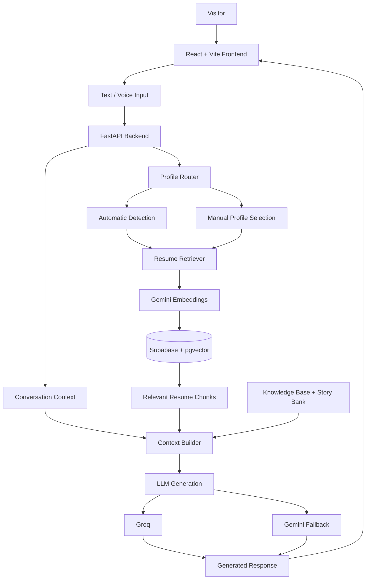

# Meet Yash — AI-Powered Voice Twin

An interactive AI-powered digital representation of Yash Kuletha that allows recruiters, interviewers, and curious visitors to explore my professional experience, technical skills, projects, and career journey through natural conversations.

**Meet Yash** combines Large Language Models, Retrieval-Augmented Generation (RAG), semantic search, automatic intent routing, and browser-based voice interaction to create a personalized interview experience.

**Live Demo:** [Meet Yash](https://meet-yash.vercel.app)  
**Backend API:** [FastAPI](https://meet-yash.onrender.com)  
**API Documentation:** [Swagger UI](https://meet-yash.onrender.com/docs)

---

## Overview

Traditional portfolios present information through static pages, project descriptions, and downloadable resumes.

Meet Yash takes a different approach.

Instead of navigating through multiple sections, visitors can simply ask questions such as:

- Tell me about your experience at XCaliber Health.
- What projects have you built using machine learning?
- Explain your experience with data engineering.
- What is your experience with Generative AI?
- How have you worked with distributed data processing?
- What makes you a good fit for a Data Scientist role?

The system retrieves relevant information from Yash's structured knowledge base and role-specific resumes before generating a contextual response.

Visitors can also interact using voice, making the experience closer to an actual interview.

---

## Key Features

### 1. Conversational AI Interview Twin

- Natural-language conversations powered by LLMs.
- Personality and response instructions designed around Yash's communication style.
- Context-aware responses using conversation history.
- Structured knowledge about education, internships, technical skills, projects, research, and leadership.
- AI disclosure to distinguish generated responses from actual human communication.

### 2. Retrieval-Augmented Generation (RAG)

Meet Yash uses a RAG pipeline to ground responses in relevant resume information.

The pipeline:

1. Extracts text from PDF resumes.
2. Splits extracted text into overlapping chunks.
3. Generates vector embeddings using Google's Gemini embedding model.
4. Stores embeddings in Supabase PostgreSQL using pgvector.
5. Retrieves semantically relevant chunks when a question is asked.
6. Supplies the retrieved context to the LLM for response generation.

This allows the system to retrieve specific information instead of relying exclusively on information embedded in the language model.

### 3. Automatic Profile Detection

The system automatically identifies the professional domain most relevant to a question.

Supported profiles:

| Profile | Focus |
|---|---|
| Data Analyst | Data analysis, SQL, Excel, Power BI |
| Data Scientist | Machine learning, statistics, model development |
| Data Engineer | ETL, Spark, PySpark, distributed systems |
| Generative AI | LLMs, RAG, AI agents, prompt engineering |
| General | Searches across all available resumes |

### 4. Manual Resume Selection

Visitors can override automatic profile detection using the profile selector.

For example, selecting **Data Scientist** directs retrieval toward the Data Scientist resume, even if the automatic router identifies another profile.

The system also supports searching across all resumes.

### 5. Voice Interaction

- Browser-based speech recognition for voice input.
- Browser Speech Synthesis API for spoken responses.
- Text and voice interaction through the same conversational interface.
- No separate speech-processing infrastructure required.

### 6. Source-Aware Responses

The backend returns retrieval metadata alongside generated answers.

This includes:
- Retrieved resume filenames.
- Associated professional profiles.
- Similarity scores.

The frontend displays the retrieved source filenames to help visitors understand which resume information contributed to an answer.

### 7. LLM Provider Fallback

The backend uses a primary and fallback generation strategy:

- **Primary:** Groq
- **Fallback:** Google Gemini

This provides an alternative generation path when the primary provider encounters an error or becomes unavailable.

---

## System Architecture



### Architecture Components

| Component | Responsibility |
|---|---|
| React + Vite | Interactive frontend and chat interface |
| FastAPI | Backend API and orchestration |
| Gemini Embeddings | Semantic representation of resume chunks |
| Supabase | Persistent vector storage |
| pgvector | Similarity-based vector retrieval |
| Groq | Primary LLM inference |
| Gemini | Fallback LLM inference |
| Web Speech API | Browser speech recognition |
| Speech Synthesis API | Browser text-to-speech |

---

## RAG Pipeline

### Resume Ingestion

Resume PDFs are processed offline through the ingestion script.

```text
PDF Resumes
     |
     v
Text Extraction
     |
     v
Text Chunking
     |
     v
Gemini Embeddings
     |
     v
Supabase PostgreSQL
     |
     v
pgvector Index
```

The ingestion process creates embeddings for individual chunks and stores them alongside their source metadata.

Run ingestion using:

```bash
python ingest_resumes.py --directory resumes
```

### Query-Time Retrieval

When a visitor asks a question:

```text
User Question
     |
     v
Profile Detection
     |
     v
Query Embedding
     |
     v
Vector Similarity Search
     |
     v
Relevant Resume Chunks
     |
     v
Context Builder
     |
     v
LLM
     |
     v
Final Response
```

The retrieval process uses cosine similarity to identify relevant resume chunks.

**Current retrieval configuration:**

| Parameter | Value |
|---|---|
| Embedding model | `gemini-embedding-001` |
| Embedding dimensions | 768 |
| Chunk size | 1200 characters |
| Chunk overlap | 180 characters |
| Default retrieval count | 5 |
| Minimum similarity | 0.30 |

### Knowledge Source Prioritization

Meet Yash uses multiple information sources:

1. **Structured knowledge base:** Authoritative personal and professional information.
2. **Story bank:** Curated experiences, challenges, achievements, and behavioral interview narratives.
3. **Resume retrieval:** Role-specific professional evidence.

The structured knowledge base and story bank remain authoritative for factual details and attribution. Resume retrieval supplements this information rather than overriding verified facts.

---

## Tech Stack

| Category | Technologies |
|---|---|
| Frontend | React, Vite, JavaScript, CSS |
| Backend | Python, FastAPI, Uvicorn |
| LLMs | Groq, Google Gemini |
| Embeddings | Gemini Embedding API |
| Vector Database | Supabase PostgreSQL, pgvector |
| RAG | PDF extraction, chunking, semantic retrieval |
| Voice | Web Speech API, Speech Synthesis API |
| Deployment | Vercel, Render |
| Version Control | Git, GitHub |

---

## Project Structure

```text
meet-yash/
│
├── backend/
│   ├── main.py
│   ├── personality.py
│   ├── knowledge_base.py
│   ├── story_bank.py
│   ├── context_builder.py
│   ├── ingest_resumes.py
│   │
│   ├── rag/
│   │   ├── __init__.py
│   │   ├── embeddings.py
│   │   ├── db.py
│   │   ├── retriever.py
│   │   ├── pdf_loader.py
│   │   ├── chunker.py
│   │   └── query_router.py
│   │
│   ├── resumes/
│   ├── requirements.txt
│   └── .env.example
│
├── frontend/
│   ├── public/
│   ├── src/
│   ├── App.jsx
│   ├── index.css
│   ├── package.json
│   └── vite.config.js
│
├── supabase_schema.sql
└── README.md
```

---

## Getting Started

### Prerequisites

Make sure you have:

- Python 3.11 or later.
- Node.js and npm.
- A Google Gemini API key.
- A Groq API key.
- A Supabase project with pgvector enabled.

### 1. Clone the Repository

```bash
git clone https://github.com/Gitgo012/meet-yash.git

cd meet-yash
```

### 2. Configure Supabase

Create a Supabase project.

Open the SQL Editor and execute the contents of:

```text
supabase_schema.sql
```

This creates the resume chunks table and the vector index required for similarity search.

Retrieve your PostgreSQL connection string from your Supabase project.

### 3. Configure the Backend

```bash
cd backend

python -m venv venv
```

Activate the environment.

Windows:

```powershell
venv\Scripts\activate
```

Linux/macOS:

```bash
source venv/bin/activate
```

Install dependencies:

```bash
pip install -r requirements.txt
```

Create a `.env` file inside the backend directory:

```env
GEMINI_API_KEY=your_gemini_api_key
GROQ_API_KEY=your_groq_api_key

GROQ_MODEL=openai/gpt-oss-120b

GEMINI_MODELS=your_configured_gemini_model_list

DATABASE_URL=your_supabase_postgresql_connection_string

RAG_MIN_SIMILARITY=0.30

FRONTEND_URL=http://localhost:5173
```

Use the same Gemini model list configured in your working backend environment.

**Never commit `.env` or expose API keys in the frontend.**

### 4. Ingest Resume Data

Place your PDF resumes inside:

```text
backend/resumes/
```

Run:

```bash
python ingest_resumes.py --directory resumes
```

The script extracts text, creates chunks, generates embeddings, and inserts the records into Supabase.

### 5. Start the Backend

From the backend directory:

```bash
uvicorn main:app --reload
```

Backend:

```text
http://127.0.0.1:8000
```

API documentation:

```text
http://127.0.0.1:8000/docs
```

### 6. Configure the Frontend

Open another terminal:

```bash
cd frontend

npm install
```

Create a `.env` file in the frontend directory:

```env
VITE_API_URL=http://127.0.0.1:8000
```

Start the frontend:

```bash
npm run dev
```

Open:

```text
http://localhost:5173
```

---

## API Overview

The FastAPI backend exposes the following endpoints:

| Endpoint | Method | Description |
|---|---|---|
| `/` | GET | Root endpoint |
| `/health` | GET | Health check |
| `/chat` | POST | Conversational AI endpoint |
| `/docs` | GET | Interactive API documentation |

### Chat Request

```json
{
  "message": "Tell me about your data engineering experience",
  "history": [],
  "profile": "auto"
}
```

Supported profile values:

```text
auto
data_analyst
data_scientist
data_engineer
genai
general
```

### Chat Response

The response contains:

```json
{
  "reply": "Generated conversational response...",
  "model_used": "groq",
  "selected_profile": "data_engineer",
  "detected_profile": "data_engineer",
  "sources": [
    {
      "source_file": "DE_Resume.pdf",
      "profile": "data_engineer",
      "similarity": 0.82
    }
  ]
}
```

*The response above illustrates the API response structure.*

---

## Deployment

Meet Yash is deployed using separate frontend and backend services.

| Layer | Platform |
|---|---|
| Frontend | Vercel |
| Backend | Render |
| Database | Supabase |
| LLM Inference | Groq and Gemini |

### Frontend — Vercel

Configure the Vercel project:

| Setting | Value |
|---|---|
| Framework | Vite |
| Root Directory | `frontend` |
| Build Command | `npm run build` |
| Output Directory | `dist` |

Add the following environment variable:

```env
VITE_API_URL=https://your-render-backend.onrender.com
```

### Backend — Render

Configure the Render Web Service:

| Setting | Value |
|---|---|
| Root Directory | `backend` |
| Build Command | `pip install -r requirements.txt` |
| Start Command | `uvicorn main:app --host 0.0.0.0 --port $PORT` |

Add the required environment variables from your local backend configuration.

Set `FRONTEND_URL` to your actual Vercel deployment URL to configure CORS.

---

## Engineering Considerations

A few important decisions shaped this implementation:

**1. Persistent vector storage**

Supabase with pgvector provides persistent storage for resume embeddings. This avoids depending on local application filesystems that may be ephemeral in cloud hosting environments.

**2. Separation of ingestion and retrieval**

Resume ingestion is performed separately from the chat request lifecycle. This avoids repeatedly extracting PDFs and generating embeddings for every conversation.

**3. Automatic and manual retrieval routing**

Automatic detection provides a convenient default, while manual profile selection gives visitors control over which professional experience they want to explore.

**4. Structured knowledge alongside RAG**

Not every personal fact belongs in a resume. The knowledge base and story bank provide curated information for behavioral questions and personal context, while RAG retrieves supporting professional evidence.

**5. LLM fallback**

Using Groq as the primary generation provider and Gemini as a fallback makes the application less dependent on a single inference provider.

---

## Future Improvements

Potential directions for further development:

- Streaming responses for lower perceived latency.
- Conversation-level memory and improved follow-up handling.
- Better retrieval evaluation using precision, recall, and relevance metrics.
- Reranking retrieved chunks before context construction.
- More granular observability for retrieval and generation.
- Token usage, latency, and provider-level monitoring.
- Improved voice interaction with interruption handling.
- Expanded interview modes for different job roles.

---

## About

**Yash Kuletha**

Computer Science graduate interested in AI Engineering, Data Science, Data Engineering, and building production-oriented AI systems.

- GitHub: [Gitgo012](https://github.com/Gitgo012)
- LinkedIn: [Yash Kuletha](https://linkedin.com/in/yash-kuletha)

---

*Meet Yash was built as an exploration of practical LLM application development, RAG architecture, semantic retrieval, prompt engineering, and conversational voice interfaces.*